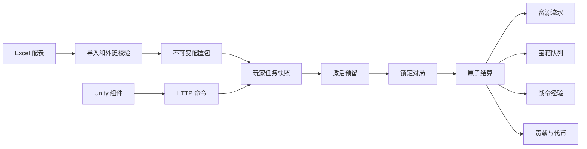

# 本机后端与数据接入

本项目使用同一份 Unity 工程。所有游戏资产直接位于 `Assets` 下，不再包含 `Assets/ClashRoyaleUI` 子项目目录。

## 文件位置

| 内容 | 项目内路径 |
|---|---|
| 主场景 | `Assets/Scenes/ClashRoyaleUI.unity` |
| 游戏逻辑与 uGUI 行为 | `Assets/Scripts/Runtime` |
| 编辑器工具 | `Assets/Scripts/Editor` |
| Excel 配表 | `Assets/Tables/ClashRoyale_V5.4.xlsx` |
| 任务卡片预制体 | `Assets/Prefabs/Components/TaskCard.prefab` |
| 页面预制体 | `Assets/Prefabs/Screens` |
| 美术、字体 | `Assets/Art`、`Assets/Fonts` |
| 本机服务代码与数据库定义 | `Backend/server.py`、`game.py`、`schema.sql` |
| 玩家数据库 | `Backend/.local/clashroyale.sqlite3` |

## 启动和调整

1. 在 Unity 打开主场景并点击 Play，编辑器会自动检查并启动本机后端，界面在服务就绪后读取数据。也可以从菜单 `Clash Royale → 本机后端联调` 点击“启动后端”和“刷新数据”，或运行 `Backend/Start-Backend.ps1`。
2. 打开主场景并进入 Play。战斗主页的任务入口进入任务列表。
3. 点击三角展开或收起。收起仅展示简述；展开显示详情、进度、消耗。接取后系统自动分配激活任务；主页紫色卷轴旁的下拉列表设置等级升序、等级降序或完成度降序。任务页顶部的分类只改变列表排序。未接取任务没有部落求助入口；接取后展开可求助或强制激活一条任务。
4. 修改 Excel 的 `brief` 或 `description` 等字段并保存；在联调窗口点击“重新导入 Excel”。验证失败不会替换当前配置。已有任务保留接取时的快照，新接取任务读取新版本。
5. 停止服务可运行 `Backend/Stop-Backend.ps1`。停止 Unity Play 不会清空数据库。重新启动服务读取已有存档。

部落主页与商店由原生 `UIClanStats` 组件订阅后端状态：个人贡献读取 `player.season_contribution`，部落代币读取独立余额 `player.tokens`，部落积分读取 `player.clan_score`。主页自己的成员行与顶部个人贡献同步。部落积分沿用服务端当前赛季成员贡献及配表衰减规则，商店消费只扣代币，不扣贡献；界面切换和服务端状态更新都会刷新这些数值。其他成员的名字、奖杯与列表仍是原型内容，不用于计算部落积分。

服务只监听 `127.0.0.1:18765`。当前完成的是同一台电脑上的 Unity Editor 联调；真机不能把 `127.0.0.1` 当作开发电脑地址。

## 对局联调

任务接取、行动点恢复/提取、开启宝箱、取消任务和对局结束后，服务端按保存的规则自动重新分配行动点与箱位。未进入对局时切换规则会立即重排；已进入对局时保持本场列表锁定，新规则下场生效。

每名玩家可以强制指定一条已接任务优先激活，必要时替换自动分配的任务；其余任务继续按规则分配。已激活任务不显示强制激活按钮。强制任务仍需足够的普通行动点和宝箱空位，不能在对局中更换。指定另一条会替换原指定，达成、取消或过期后自动清除。规则与指定任务保存在 `task_activation_preferences`，重启后保留。

主页匹配按钮进入本机训练营：`POST /v1/training/start` 锁定已激活任务，Unity 完成对局后调用 `/v1/training/{battle_id}/finish`。不论胜负，从本场锁定列表随机完成最多两条任务；只有一条时完成一条，没有任务也可以对局。沿用原子结算、行动点扣除、奖励入队与幂等规则。训练模式不使用任务条件判定，这是当前演示的专用规则。它是本机训练对局，不是联网权威战斗服务器。

重新进入主场景时，`POST /v1/training/leave` 将中断的训练记录标为 `abandoned`，释放其任务预留，不扣行动点、不发奖励，并重新按规则激活已接取任务。新的匹配会创建新对局，不沿用旧对局的空任务列表。蓝色卷轴统计未完成的已接取任务（含已激活），紫色卷轴只统计已激活任务。

联调窗口点击“开始对局”后，任务与配置版本锁定。

窗口中的“对局事实”是可编辑 JSON。字段包含模式、胜负、8张卡牌、卡组条件和使用次数。提交模拟对局后，后端检查已锁定任务条件并结算。未激活任务不计进度；投降、掉线、挂机、消极对战、重复对手滥用和非允许模式不发奖。

Unity 游戏客户端凭证不能调用 `/admin/` 结算端点。管理凭证只由编辑器联调工具使用。实际战斗服务器和真实卡牌目录尚未提供，卡组历史、所有权、试用资格和反作弊事实仍由联调输入模拟；后续对接 `DeckCheck` 时应从权威战斗记录生成这些字段。

## 数据流与数据库

Excel 是运行配置的入口。`import_config.py` 读取 XLSX 原生单元格，校验任务总数、等级配额、主键、奖励外键、条件字段、40级战令及付费轨道不产行动点。导入生成内容哈希标识的不可变配置包。服务启动时自动导入；运行中可手动重新导入。

| 表 | 关键约束与职责 |
|---|---|
| `config_bundles` / `task_templates` | 内容哈希唯一；包版本与任务ID联合主键；配置可追溯 |
| `players` | 玩家资源、行动点双池、恢复时间、赛季经验和代币 |
| `task_instances` | 独立接取实例；保留任务文字、条件、目标、奖励引用的配置快照 |
| `task_activation_preferences` | 每玩家一条优先级规则和最多一条强制任务；不写入 Excel |
| `activations` | 同一任务仅一条有效预留；分别记录行动点和箱位 |
| `battles` | 同一玩家仅一场运行中对局；锁定池版本与赛季 |
| `settlements` | 接取实例与激活记录各自唯一，防止重复发奖 |
| `first_clears` | 玩家、赛季、任务模板联合唯一 |
| `chests` | 每个任务独立入队，来源结算唯一；保留四次升星结果与最终奖励 |
| `chest_openings` | 每个宝箱保存当前星级、已判定次数和逐次结果；第四次才发奖 |
| `player_items` | 普通、稀有、史诗、传奇万能卡分别记录库存 |
| `pass_claims` | 玩家、赛季、等级、轨道联合唯一 |
| `clan_members` / `contribution_events` | 个人贡献与代币分开记账；结算来源唯一 |
| `task_help_requests` | 只能由已接取或已激活实例产生；同一实例唯一 |
| `resource_ledger` | 资源变化、来源、变化后余额均可追溯 |
| `request_results` | 请求编号和参数指纹；相同请求返回原结果，换参数拒绝 |
| `events` | 接取、激活、取消、结算等行为记录 |

所有写命令在 `BEGIN IMMEDIATE` 事务中完成，SQLite 启用 WAL 和外键。结算中途失败会全部回滚，原预留保留以便重试。配置导入不会覆盖既有任务和宝箱的锁定版本。[SQLite 事务说明](https://www.sqlite.org/lang_transaction.html)。Unity 使用 [UnityWebRequest](https://docs.unity.com/en-us/engine/6000.3/script-reference/unityengine/networking/unitywebrequest) 读取状态和发送命令。

战令的免费、战令两条轨道各40级。`奖励`表的 `gold/cards/ap` 保留原含义，`resource/amount` 配置宝石或四种万能卡，`chest_star` 配置入队宝箱的初始星级。`战令40级`引用对应奖励ID，界面与实际发奖读取同一份配置。现有赛季已领取记录保留，不因换表重复领取。

本机原型点击皇冠锁调用 `POST /v1/pass/unlock`，写入 `players.premium=1`，不扣款。领取写入 `pass_claims`，金币和宝石更新 `players`，万能卡更新 `player_items`，宝箱单独加入 `chests`；资源变化同时写入 `resource_ledger`。

开箱每次调用 `POST /v1/chests/{box_id}/open`，提交 `step=1..4`。服务端每步只抽一次，重复提交不重抽；第四次把发奖、开箱结果与完成状态写入同一个事务。Unity只负责绕中心竖直轴旋转、放大、换色和展示返回的奖励图标。

## 已实现的规则

- 62条模板：25一级、20二级、16三级、1特殊；每天固定选择8/6/5/1。接取后不会无限补位，当天未选中的任务不能接取。旧接取任务在每日轮换后保留。
- 接取免费、无接取数量限制；接取后自动激活，只有本场激活任务计进度。预留不扣账面行动点；达成后实际扣点并增加等量战令经验。
- 普通池24、储备16、每6小时恢复2或满池时储备1；手动提取不溢出，不清掉剩余储备。
- 宝箱20槽，包括有效预留；开箱4次独立30%升星判定，最高5星，重复开启不重复发奖。
- 免费取消每日3次，之后按塔等级收费；新手免费。收费参数可配置。
- 每赛季首次模板奖励、40级战令逐轨道领取、贡献冷却与跨阈值分段衰减、代币独立余额、部落行动点兑换额度。
- 周切换保留已进入对局的旧任务，结算后清理；未进入对局的旧任务过期；宝箱和储备不清除。
- 配置开关、任务/结算/宝箱/战令领取的幂等约束与资源流水。

## 需要接入真实游戏数据的部分

这次服务以单个本机玩家 P001 为入口。账号登录、真实战斗服务器、卡牌与卡组历史、禁用卡规则、部落转会、五部落竞赛编组和赛季结算调度尚未连接外部系统。当前部落计分演示使用基准人数30；不能视为正式线上竞赛结果。跨赛季在途对局未定义最终记账口径时会保留并拒绝结算，不擅自计入任一赛季。付费战令开通尚未接入支付。

V5.4 与 FigJam 的差异记录：FigJam 原生表 `290:5557` 的队列容量仍为8，采用 V5.4 正文的20。文档没有列全62个完整任务；配表已经补齐。原文未明确的收费系数、贡献阈值、非案例奖励和额外行动点预算，采用可修改的本机数值；这些说明只保存在本文件，不写进 Excel。

## 验证

`python -m unittest discover -s Backend -p test_game.py -v`

25项测试已通过，包含62条条件逐条达成、V5.4算例、重复请求、并发资源预留、失败回滚、无效对局、历史版本锁定、周刷新、储备持久化、自动激活重排、单条强制及取消强制、对局锁定、恢复/开箱后自动补位和客户端/管理端权限检查。最新报告为 `Backend/Validation/auto-activation-tests.txt`。Unity 交互使用 EventSystem 点击与 ScrollRect 拖动事件验证，未将桌面鼠标自动化或真机测试计入。
